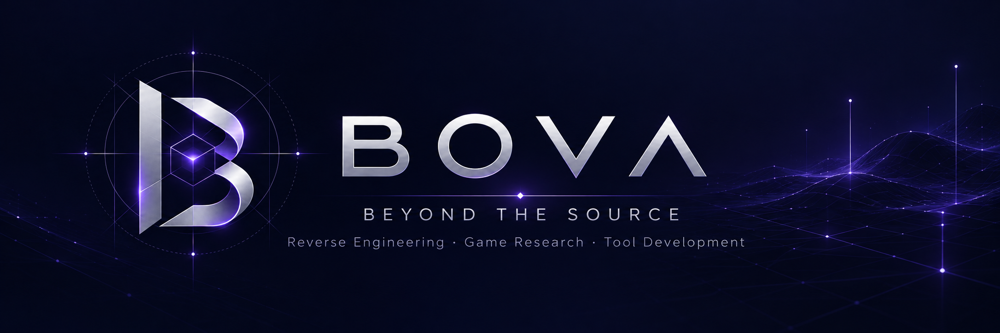

**Reverse Engineering · Game Research · Tool Development**

*Understanding what's hidden. Building what's missing.*

---

### About

**BOVA** is an independent game technology research initiative.

We explore undocumented file formats, game clients and assets, and develop tools to better understand how they work.

Our focus is on technical exploration, practical tooling, and preserving knowledge that might otherwise be lost.

### What We Explore

| Research | Tools & Preservation |
| --- | --- |
| **Binary Formats** — files, archives, data structures | **Custom Tools** — extraction, inspection, visualization |
| **Game Assets** — 3D geometry, textures, maps | **Digital Preservation** — documentation and legacy resources |
| **Reverse Engineering** — undocumented systems | **Research Workflows** — understanding and rebuilding |

### Featured Research

**Allods Online — Reverse Engineering & Client Research**

A look back at our earlier work exploring the game's internals, analyzing its client, and building custom tools.

[Read our research story →](https://community.allods-developers.eu/threads/ot-lubvi-k-allodam-ili-pocemu-my-vzalis-za-revers-inziniring.709/)

### Current Direction

We're interested in lightweight tools for exploring binary data, game assets, and map formats.

Public repositories and documentation will appear here as they're ready.

### Collaboration

Have technical insights, unusual file formats, or legacy development resources to discuss?

We're open to exchanging knowledge and exploring ideas together.

---

*Research. Understand. Rebuild.*

**BOVA · Independent Research & Development**
